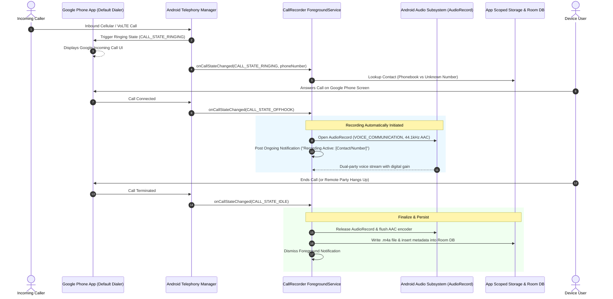

# Automatic Call Recording Mobile System - Implementation Plan

## Goal Description
Develop a comprehensive, secure, and user-friendly Automatic Call Recording application for Android mobile devices (compatible with Android 10 through 15+ / API 29–35+). 

The software operates seamlessly in **Companion Mode** alongside the pre-installed **Google Phone app (`com.google.android.dialer`)**, automatically initiating high-fidelity audio recording the instant an incoming or outgoing call connects (`CALL_STATE_OFFHOOK`), for both saved contacts and unknown phone numbers. 

To eliminate any security threat to the device, the app implements a **Zero-Network Air-Gapped Architecture** (omitting the `INTERNET` permission entirely), ensuring that recorded conversations and contact data can never leave the device. All recordings are organized in app-private scoped storage, indexed in a Jetpack Room database, and managed through a modern Jetpack Compose Material 3 interface equipped with search, categorization, and an interactive waveform audio player.

---

## User Review Required & Design Resolutions

During our design alignment, the following foundational architectural decisions were established:

> [!IMPORTANT]
> **Coexistence with Google Pre-installed Phone App (`com.google.android.dialer`)**
> - **Companion Mode**: The Google Phone app remains the active dialer and in-call screen. The user continues to answer, dial, and manage calls through Google Phone without interruption or UI hijacking.
> - **Telephony State Listener**: Our app listens passively to official Android OS telephony broadcast and callback events (`TelephonyCallback.CallStateListener` on Android 12+ / `PhoneStateListener` on Android 10–11). When Google Phone connects a call, our app detects the state transition from `RINGING` to `OFFHOOK` and starts recording within milliseconds.

> [!IMPORTANT]
> **Zero-Threat Security & Mobile Firewall Posture**
> - **Air-Gapped (Zero Network Access)**: The `android.permission.INTERNET` permission is **completely omitted** from `AndroidManifest.xml`. At the Linux kernel and SELinux level, Android physically forbids the app from opening network sockets. Mobile firewalls, antivirus, and Google Play Protect will recognize the app as 100% offline with zero threat of data exfiltration.
> - **Standard Public APIs Only**: Uses official `AudioRecord` with `AudioSource.VOICE_COMMUNICATION` and digital gain amplification. No hidden APIs, no root, and no prohibited Accessibility API exploits—completely compliant with Google Play Protect and Android security baselines.

> [!NOTE]
> **Key Operational Parameters Resolved**:
> - **Background Persistence**: An official `ForegroundService` with a non-intrusive status bar notification (`type="microphone|phoneCall"`) combined with a one-time battery optimization exemption (`REQUEST_IGNORE_BATTERY_OPTIMIZATIONS`), preventing Android Doze mode or OEM battery managers (Pixel, Samsung, Xiaomi) from terminating active recordings.
> - **Default Recording Scope**: Automatically records **all connected calls** (both known contacts and unknown numbers) out-of-the-box, with exclusion settings available for specific contacts.
> - **Audio Codec & Storage**: High-efficiency AAC-LC in an MPEG-4 container (`.m4a`) at ~1 MB per minute. Stored permanently in app-private internal storage (`context.filesDir/recordings/`) until deleted by the user.
> - **Frictionless UI Access**: No mandatory in-app biometric lock delaying access; relies on the user's device lock screen for physical security, while scoped storage isolates audio from other third-party apps.

---

## Technical Integration: How It Interacts with the Phone & Google Caller



---

## Proposed Project Structure & Components

```
app/src/main/
├── AndroidManifest.xml                        # Strict permissions: NO INTERNET!
├── java/com/callrecorder/app/
│   ├── CallRecorderApp.kt                     # Application entry & Hilt/Dependency container
│   ├── core/
│   │   ├── audio/
│   │   │   ├── AudioRecorderEngine.kt         # AudioRecord worker with VOICE_COMMUNICATION
│   │   │   ├── AudioGainProcessor.kt          # Software digital gain & speech amplification
│   │   │   ├── AudioEncoder.kt                # MediaCodec AAC-LC encoder writing .m4a
│   │   │   └── WaveformExtractor.kt           # Generates amplitude data for visual scrubber
│   │   ├── telephony/
│   │   │   ├── CallStateReceiver.kt           # BroadcastReceiver for boot and phone state
│   │   │   ├── ModernTelephonyCallback.kt     # TelephonyCallback.CallStateListener (API 31+)
│   │   │   ├── CallRecordingService.kt        # ForegroundService managing active recording
│   │   │   └── ContactLookupManager.kt        # ContactsContract resolver (Name, Photo, Unknown)
│   │   ├── storage/
│   │   │   ├── StorageManager.kt              # App-private scoped storage & file naming
│   │   │   └── StorageCleaner.kt              # Optional auto-cleanup / retention manager
│   │   └── utils/
│   │       ├── BatteryOptimizationHelper.kt   # Prompts ignore battery optimization
│   │       └── PermissionHelper.kt            # Runtime permission request coordinator
│   ├── data/
│   │   ├── local/
│   │   │   ├── CallRecordDatabase.kt          # Room Database definition
│   │   │   ├── CallRecordDao.kt               # Reactive Room DAO with search & filters
│   │   │   └── entity/
│   │   │       ├── CallRecordEntity.kt        # Table schema for indexed recordings
│   │   │       └── CallCategory.kt            # Enum: ALL, KNOWN, UNKNOWN, FAVORITE, BUSINESS
│   │   └── repository/
│   │       └── CallRecordRepositoryImpl.kt    # Repository bridging DB and audio files
│   ├── domain/
│   │   ├── model/
│   │   │   ├── CallRecord.kt                  # Domain model for call records
│   │   │   └── CallFilter.kt                  # Filter criteria model (date range, type, query)
│   │   ├── repository/
│   │   │   └── CallRecordRepository.kt        # Domain interface
│   │   └── usecase/
│   │       ├── GetCallRecordsUseCase.kt
│   │       ├── SearchCallRecordsUseCase.kt
│   │       ├── DeleteCallRecordUseCase.kt
│   │       └── ToggleFavoriteUseCase.kt
│   └── ui/
│       ├── MainActivity.kt                    # Single Activity container
│       ├── theme/
│       │   ├── Color.kt, Type.kt, Theme.kt    # Material Design 3 theme
│       ├── navigation/
│       │   └── NavRoutes.kt                   # Compose Navigation graph
│       ├── screens/
│       │   ├── dashboard/                     # Main call list with tabs, cards & play buttons
│       │   ├── player/                        # Bottom sheet waveform player with speed controls
│       │   ├── search/                        # Real-time search by contact/number/date
│       │   └── settings/                      # Automation toggles, gain boost, storage info
│       └── components/                        # RecordingListItem, WaveformScrubber, CategoryChip
```

---

## Detailed Component Specifications

### 1. Zero-Threat Manifest Configuration (`AndroidManifest.xml`)

```xml
<manifest xmlns:android="http://schemas.android.com/apk/res/android"
    package="com.callrecorder.app">

    <!-- STRICT ZERO-NETWORK POSTURE: NO android.permission.INTERNET! -->

    <!-- Telephony & Call Detection -->
    <uses-permission android:name="android.permission.READ_PHONE_STATE" />
    <uses-permission android:name="android.permission.READ_CALL_LOG" />
    <uses-permission android:name="android.permission.READ_CONTACTS" />

    <!-- Audio Recording -->
    <uses-permission android:name="android.permission.RECORD_AUDIO" />
    <uses-permission android:name="android.permission.MODIFY_AUDIO_SETTINGS" />

    <!-- Foreground Service & Reliability -->
    <uses-permission android:name="android.permission.FOREGROUND_SERVICE" />
    <uses-permission android:name="android.permission.FOREGROUND_SERVICE_MICROPHONE" />
    <uses-permission android:name="android.permission.FOREGROUND_SERVICE_PHONE_CALL" />
    <uses-permission android:name="android.permission.POST_NOTIFICATIONS" />
    <uses-permission android:name="android.permission.WAKE_LOCK" />
    <uses-permission android:name="android.permission.REQUEST_IGNORE_BATTERY_OPTIMIZATIONS" />
    <uses-permission android:name="android.permission.RECEIVE_BOOT_COMPLETED" />

    <application
        android:name=".CallRecorderApp"
        android:allowBackup="false"
        android:icon="@drawable/ic_launcher"
        android:label="@string/app_name"
        android:roundIcon="@drawable/ic_launcher_round"
        android:theme="@style/Theme.CallRecorder">

        <service
            android:name=".core.telephony.CallRecordingService"
            android:exported="false"
            android:foregroundServiceType="microphone|phoneCall" />

        <receiver
            android:name=".core.telephony.CallStateReceiver"
            android:exported="true">
            <intent-filter>
                <action android:name="android.intent.action.PHONE_STATE" />
                <action android:name="android.intent.action.BOOT_COMPLETED" />
            </intent-filter>
        </receiver>

        <activity
            android:name=".ui.MainActivity"
            android:exported="true"
            android:windowSoftInputMode="adjustResize">
            <intent-filter>
                <action android:name="android.intent.action.MAIN" />
                <category android:name="android.intent.category.LAUNCHER" />
            </intent-filter>
        </activity>
    </application>
</manifest>
```

---

### 2. Audio Capture Engine with Digital Gain (`core/audio`)

#### `AudioRecorderEngine.kt` & `AudioGainProcessor.kt`
- Implements `AudioRecord` initialized with:
  - **Source**: `MediaRecorder.AudioSource.VOICE_COMMUNICATION` (activates hardware Acoustic Echo Cancellation and Automatic Gain Control).
  - **Sample Rate**: 44,100 Hz, 16-bit PCM, Mono/Stereo.
  - **Buffer Sizing**: Dynamic based on `AudioRecord.getMinBufferSize()`.
- **Software Digital Gain**: Applies linear PCM gain scaling (1.5x–2.5x adjustable in settings) to ensure that the remote party's voice coming through the earpiece/speaker is amplified to matching loudness with the user's local voice.
- **MediaCodec AAC Encoder**: Encodes the amplified PCM stream directly into high-efficiency AAC-LC (`.m4a` format) with a target bitrate of 96–128 kbps.

---

### 3. Contact Classification & Database Engine (`core/telephony` & `data/local`)

#### `ContactLookupManager.kt`
- Fast query against `ContactsContract.PhoneLookup`:
  - Returns contact display name, photo thumbnail URI, and phone label (Mobile, Work, etc.).
  - If no record matches: Labels call as `"Unknown Caller"` (`isKnownContact = false`).

#### `CallRecordEntity.kt` & `CallRecordDao.kt`
```kotlin
@Entity(tableName = "call_recordings", indices = [Index("phoneNumber"), Index("timestamp")])
data class CallRecordEntity(
    @PrimaryKey(autoGenerate = true) val id: Long = 0,
    val filePath: String,
    val fileName: String,
    val fileSizeBytes: Long,
    val durationSeconds: Long,
    val phoneNumber: String,
    val contactName: String?,
    val contactPhotoUri: String?,
    val isKnownContact: Boolean,
    val callType: String, // "INCOMING" or "OUTGOING"
    val timestamp: Long,   // System.currentTimeMillis()
    val category: String,  // "ALL", "PERSONAL", "BUSINESS"
    val isFavorite: Boolean = false,
    val notes: String? = null
)
```
- Reactive search query via Kotlin `Flow`:
```sql
SELECT * FROM call_recordings 
WHERE (:category = 'ALL' OR category = :category)
  AND (:onlyUnknown = 0 OR isKnownContact = 0)
  AND (:onlyFavorites = 0 OR isFavorite = 1)
  AND (contactName LIKE '%' || :query || '%' 
       OR phoneNumber LIKE '%' || :query || '%' 
       OR notes LIKE '%' || :query || '%')
ORDER BY timestamp DESC
```

---

### 4. User Interface & Playback Experience (`ui`)

- **Dashboard Screen**:
  - Filter chips / tabs: `All Calls`, `Known Contacts`, `Unknown Numbers`, `Favorites`.
  - Recording Cards: Contact avatar with initials or photo, Contact name or formatted number, Inbound/Outbound badge, call duration, timestamp, and instant Play button.
- **Waveform Player Bottom Sheet**:
  - Visual audio amplitude bar representation.
  - Controls: Play/Pause, Rewind 10s, Fast-forward 10s, timeline drag-scrubber.
  - Playback speed chips: `0.75x`, `1.0x`, `1.25x`, `1.5x`, `2.0x`.
  - Tagging: Quick buttons to mark as Favorite, add notes, or set category (Personal/Business).
- **Settings Screen**:
  - Automatic Recording master switch (Default: On).
  - Record Unknown Numbers switch (Default: On).
  - Software Audio Gain slider (Default: 1.8x).
  - Storage stats (Total recordings, disk space used) and auto-cleanup options.
  - Verification badge: "Air-Gapped / Offline Guaranteed (No Internet Permission)".

---

## Verification Plan

### Automated Tests
1. **Unit Tests (`test/`)**:
   - `ContactLookupManagerTest`: Validates phone number parsing, format normalization, and correct classification of saved contacts vs unknown callers.
   - `AudioGainProcessorTest`: Validates PCM byte scaling, soft clipping prevention (saturation clamping at [-32768, 32767]).
   - `CallRecordDaoTest`: In-memory SQLite tests for search queries, category filters, and sorting.
2. **Security & Manifest Auditing**:
   - Verification test checking that `android.permission.INTERNET` is strictly absent from the compiled manifest.

### Manual Verification
1. **Google Phone Coexistence**:
   - Place an incoming call using the emulator console (`adb emu gsm call +15551234567`).
   - Verify Google Phone app displays the incoming call screen normally.
   - Answer the call: Verify `CallRecordingService` posts the ongoing recording notification.
   - End the call: Verify recording stops cleanly, notification dismisses, and the recording appears instantly in the Dashboard.
2. **Audio Playback & Scrubber**:
   - Play the recorded call: Test scrubbing forward/backward, waveform rendering, and variable speed toggles.
3. **Filter & Search Verification**:
   - Filter by "Unknown Numbers": Ensure only unknown numbers appear.
   - Search by digits or letters: Verify instant reactive list updates.
